# Antes de la IA, los datos: control de calidad de la ruta de un vehículo autónomo de captura

**Ingeniería de datos y ciencia de datos clásica sobre el registro de un robot que sigue una ruta programada, como paso previo a la fotogrametría (SfM) y al modelado 3D con *Gaussian Splatting*.**

*Leonan Vasconcelos, octubre de 2026*

---

## Resumen

Un vehículo autónomo que sigue una ruta programada toma cientos de capturas con un patrón fijo: misma altura, misma inclinación del sensor y direcciones que se repiten. Pero no todas las capturas son de la misión. También están las de la salida, las del camino de ida y vuelta, las de la llegada, las tomadas con el vehículo parado y las de un giro lento del sensor. Para la reconstrucción 3D esas capturas no son "un poco de ruido": la confunden. En modelos de *Gaussian Splatting* el resultado puede ser catastrófico, con nubes flotantes, bordes falsos y zonas deformadas.

Este artículo muestra cómo detectar las capturas fuera de patrón **antes** de gastar horas de GPU y de análisis humano. Usamos solo los metadatos y técnicas clásicas: variables bien construidas, filtros físicos, normalización con sentido y un agrupamiento por densidad (HDBSCAN). Solo hacen falta la posición, la orientación y la hora de cada captura: vale para cualquier vehículo autónomo, aéreo, terrestre o acuático, que registre la pose de su sensor.

El resultado decide una de tres cosas:

| Veredicto | Cuándo | Qué se hace |
|---|---|---|
| **Aceptar** | Casi todo es misión y los grupos son los del plan | Entrenar con las capturas de misión |
| **Filtrar** | Hay capturas fuera de patrón, pero la misión está completa | Quitar el ruido y entrenar |
| **Descartar** | Falta una parte de la misión o la reconstrucción se deforma | Repetir la ruta antes de procesar |

> *Gaussian Splatting* se publicó en 2023 y es la técnica más reciente de esta cadena. Pero su calidad sigue dependiendo de técnicas de hace décadas: geometría proyectiva, estadística robusta, agrupamiento por densidad y, sobre todo, una buena revisión humana de los datos de entrada. Ese trabajo previo es lo que separa a un buen profesional de uno malo.

---

## 1. El problema

La cadena de trabajo es la habitual. La SfM (*Structure from Motion*) calcula desde las capturas la pose de cada una y una nube de puntos; COLMAP y OpenSfM son dos programas que la hacen. Una captura **nadir** mira en vertical hacia abajo; una **oblicua** mira inclinada, por ejemplo a 40 grados de la vertical.

```
capturas del sensor -> SfM (COLMAP / OpenSfM) -> poses + nube de puntos -> entrenamiento del splat (GPU, ~1 h)
```

Cada etapa confía en la anterior. Si entran capturas que no siguen el patrón:

- **SfM** tiene que encajar capturas con otra escala (otra altura), otro ángulo o casi horizontales. Los errores de esas capturas se reparten por todo el bloque y pueden **curvar** la reconstrucción entera (lo vemos en el caso de João Pinheiro h45a).
- **El splat** intenta explicar a la vez todas las capturas. Una captura del camino, tomada desde fuera del área, obliga a crear gaussianas para el horizonte, el cielo o zonas vistas una sola vez. Son las "nubes" que flotan delante del observador y los bordes sucios.
- **El coste se paga tarde**: una hora de GPU, después horas de inspección humana del modelo, y al final la causa está en 30 capturas de 900.

### 1.1 Por qué el horizonte y los giros bruscos hacen tanto daño

Una captura que mira al horizonte ve sobre todo cielo y paisaje lejano. El cielo no tiene puntos fijos que reconocer. El paisaje lejano aparece en esa captura y en ninguna otra. Para la SfM es una captura casi sin puntos en común con el resto, y lo poco que encaja lo encaja mal. Para el splat es peor: tiene que inventar gaussianas que expliquen ese fondo desde un solo punto de vista, y esas gaussianas quedan flotando entre el terreno y el observador.

Un cambio brusco de dirección tiene el mismo efecto a menor escala. Dos capturas seguidas con direcciones muy distintas comparten poca escena, y la reconstrucción pierde el encadenamiento suave de una captura a la siguiente. La ruta ideal mantiene la dirección del sensor durante muchas capturas seguidas y la cambia solo en los extremos de cada pasada, fuera del área de interés.

### 1.2 El efecto: un splat que se rompe

Las dos vistas son del mismo splat de Rojales, entrenado con todas las capturas, antes de quitar las que este método marca como fuera de patrón.

<table>
<tr>
<td width="50%" valign="top">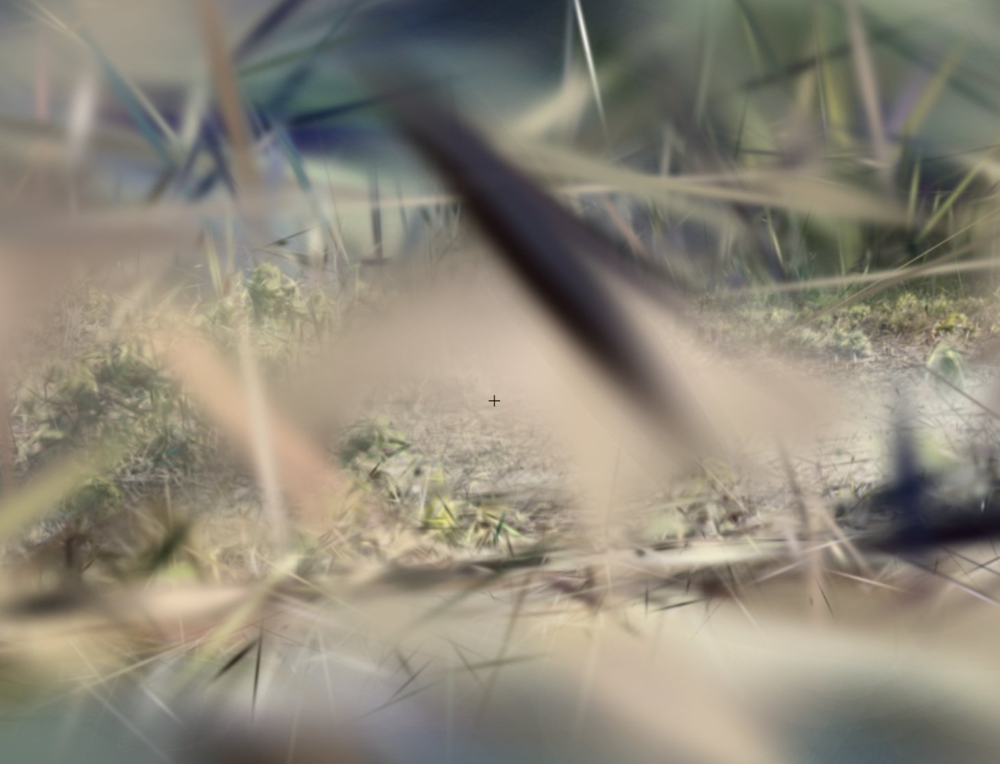</td>
<td width="50%" valign="top">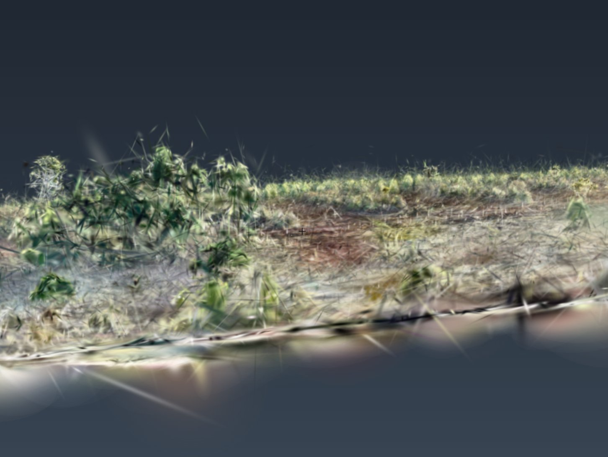</td>
</tr>
<tr>
<td valign="top">Las capturas fuera de patrón, aunque sean de la misma área, rompen el modelado. Crean gaussianas enormes que tapan a las correctas.</td>
<td valign="top">Las gaussianas correctas. Son las que se acercan a la escena modelada.</td>
</tr>
</table>

No es un defecto del entrenamiento. El modelo hace bien su trabajo con los datos que recibe. El error está en los datos.

Revisar el registro de la ruta cuesta segundos. Por eso va primero.

---

## 2. Los datos brutos

### 2.1 Metadatos de cada captura

Cada imagen trae dentro un bloque de texto XMP (metadatos que el sensor escribe en el archivo) con la pose del sensor en el momento de la captura. Ejemplo real de Rojales (captura 0251; coordenadas recortadas y nombres de campo traducidos):

```
latitud            +38.083...
longitud           -0.727...
altitud_absoluta   +94.086
altura_relativa    +59.800     metros sobre el punto de salida
pitch_sensor       -50.00      -90 = vertical; -50 = 40 grados de inclinacion
yaw_sensor         +92.30
yaw_vehiculo       +90.00      rumbo: 90 = mira al este
pitch_vehiculo     -6.10
roll_vehiculo      +10.40
```

La hora sale del nombre del archivo: `<prefijo>_20260823150142_0251.JPG` → 23/08/2026 15:01:42, captura 251.

### 2.2 Leer solo lo necesario

Una captura original pesa entre 3 y 16 MB (Divinópolis, unos 2,7 MB), según el sensor, y una ruta tiene cientos. Pero el bloque XMP está al principio del archivo: en las 7.563 capturas del estudio termina siempre antes de los 50 KB. Basta leer el principio de cada archivo y parar en cuanto aparece el final del bloque. No hace falta abrir la imagen ni usar una librería de EXIF.

```python
TROZO = 64 * 1024        # 65.536 bytes (64 KB): lo que se lee de cada vez
LIMITE = 1024 * 1024     # 1.048.576 bytes (1 MB): si el bloque no acaba antes, se deja de buscar
FIN = b"</x:xmpmeta>"    # la etiqueta que cierra el bloque XMP

with open(ruta, "rb") as f:                     # "rb": leer bytes, no texto
    leido = b""                                 # lo leido hasta ahora (vacio al empezar)
    while FIN not in leido and len(leido) < LIMITE:
        trozo = f.read(TROZO)                   # los 64 KB siguientes, nunca el archivo entero
        if not trozo:                           # el archivo se acabo sin encontrar el bloque
            break
        leido += trozo
# En este estudio el bucle da siempre una sola vuelta: el bloque cabe en el primer trozo.
```

| Las 10 rutas del estudio | Tamaño |
|---|---|
| Imágenes completas (7.563 capturas) | 94,0 GB |
| Lo que se lee: un trozo de 64 KB por captura | **496 MB (0,5 %)** |

Rojales se analiza entero en 5 s, gráficos incluidos. Es la diferencia entre un control que se hace siempre y uno que se salta por pereza.

### 2.3 Poses de la reconstrucción (COLMAP)

Si la ruta ya se procesó, la SfM entrega las poses en formato COLMAP: la rotación (cuaternión) y la traslación de cada captura en el marco del modelo. Es más preciso que el GPS, pero solo existe después de la SfM. Comparar las dos fuentes es en sí una prueba de calidad (sección 6.2).

---

## 3. Ingeniería de datos

### 3.1 Variables de cada captura

| Variable | Cómo se calcula | Qué dice |
|---|---|---|
| inclinación | ángulo del eje del sensor con la vertical | 0 = nadir, 40 = oblicua, 90 = horizonte |
| rumbo | dirección del lado de arriba de la imagen | hacia dónde mira el sensor (N, E, S, O) |
| altura | sensor sobre el suelo (con poses de la SfM) o sobre el punto de salida (solo EXIF) | la escala de la imagen |
| tiempo | hora del nombre del archivo | el orden de la ruta |
| **apunta** | rumbo menos la dirección del vehículo al centro del área, de −180 a 180 | 0 = mira hacia dentro, ±180 = hacia fuera, ±90 = de lado |
| **d_incl, d_alt** | cambio de inclinación (grados) y de altura (%) frente a la captura vecina en el tiempo | estabilidad |

Las dos últimas variables son la clave de todo el método. No están en los datos: hay que construirlas.

**La estabilidad.** En una misión, la inclinación y la altura se quedan fijas durante muchas capturas seguidas. En la salida, en el camino y en la llegada cambian en cada captura: el sensor sube o baja unos 2 grados cada 2 segundos. Sin esta variable, un agrupamiento ve una cadena de capturas de camino, cada una casi igual a la anterior, y la toma por un grupo denso.

```python
# Para cada captura i, se busca la vecina en el tiempo que más se le parece
# y se guarda cuánto cambian la inclinación y la altura entre las dos.
for i in range(n):
    candidatas = []
    for j in (i - 1, i + 1):                         # la captura anterior y la siguiente
        if 0 <= j < n and abs(t[j] - t[i]) <= 10:    # solo si está a 10 s o menos
            cambio_incl = abs(inc[i] - inc[j])       # en grados
            cambio_alt = abs(log(alt[i] / alt[j]))   # relativo: 0,02 = un 2 %
            candidatas.append((cambio_incl, cambio_alt))
    if candidatas:
        # la vecina más parecida: cada cambio se mide frente a su umbral (1,5 grados y 2 %)
        d_incl[i], d_alt[i] = min(candidatas, key=lambda c: c[0] / 1.5 + c[1] / 0.02)
```

**"Apunta".** Hay rutas en cuadrícula, donde el sensor mira siempre al mismo rumbo, y rutas en órbita o espiral, donde mira al centro (o hacia fuera) desde todos los lados. En una espiral el rumbo absoluto da toda la vuelta y no forma grupos. El rumbo relativo al centro sí.

### 3.2 Filtros físicos: categorización por reglas, antes de agrupar

Hay cosas que no necesitan estadística. Cada regla pone una etiqueta, y cada captura queda en la primera que cumple:

| Categoría | Regla | Ejemplo |
|---|---|---|
| Duplicada (casi idéntica) | sensor a < max(1 m, 3 % de la altura) y dirección a < 5 grados de una captura anterior | el vehículo parado al final de cada pasada |
| Horizonte | inclinación ≥ 80 grados | capturas en el suelo o mirando al paisaje |
| Camino | d_incl > 1,5 grados o d_alt > 2 % | el sensor o la altura cambian de captura a captura |

Las duplicadas no son archivos repetidos. Son capturas distintas, tomadas casi desde el mismo punto y en la misma dirección. Por eso una comparación de archivos no las encuentra: hay que compararlas por su pose. Se queda la primera y el resto sale.

### 3.3 Transformación y normalización con sentido físico

Lo habitual es dividir cada variable por su desviación estándar (*z-score*). Aquí no funciona: dentro de una misión las capturas casi no varían, y la desviación daría escalas absurdas. Cada variable se divide por **la diferencia que todavía cuenta como "igual"**:

| Variable | Transformación | Tolerancia | Variable normalizada |
|---|---|---|---|
| inclinación | ninguna | 3 grados | `inc / 3` |
| altura | logaritmo: lo que importa es la escala relativa | 5 % | `log(alt) / log(1.05)` |
| rumbo o "apunta" | codificación circular: 359° y 1° quedan juntos | 15 grados | `(sin, cos) / 0.26` |

Así una distancia de 1 en el espacio normalizado significa lo mismo en todas las variables: "en el límite de ser la misma captura".

### 3.4 Selección de variables

Dos procesados separados, cada uno con su gráfico:

| Procesado | Variables | Por qué no más |
|---|---|---|
| Nadir (inclinación < 15°) | inclinación, altura | el rumbo de una nadir no dice nada |
| Oblicuas | inclinación, altura, dirección | — |

La posición del vehículo y las distancias al centro **no entran** en ninguno. La posición dice *dónde* se tomó la captura, no *de qué tipo* es: una nadir de misión en el borde del área y otra en el centro son del mismo tipo, aunque estén lejos. Con la posición, HDBSCAN separaba capturas del mismo tipo solo por estar lejos: partía la espiral en anillos y marcaba como ruido los tramos rectos entre anillos.

Para las oblicuas hay dos esquemas de dirección: rumbo absoluto (cuadrícula) o "apunta" (órbita). Se prueban los dos y se elige con una medida de estadística circular: gana el esquema que deja más capturas en grupos de dirección concentrada (longitud media resultante > 0,7). Nadie tiene que decir qué tipo de ruta es.

---

## 4. Ciencia de datos: agrupar con HDBSCAN

HDBSCAN es aprendizaje no supervisado por densidad. No necesita saber cuántos grupos hay y marca como ruido lo que no pertenece a ningún grupo. Es justo lo que buscamos. Pero tal cual no sirve: dentro de una misión todas las capturas son "iguales", y HDBSCAN busca diferencias de densidad aunque no las haya. Partía la nadir de João Pinheiro en 13 grupos y dejaba como ruido la mitad de las nadir de Rojales. Dos parámetros lo arreglan:

```python
# Z: una fila por captura, con las variables ya normalizadas (sección 3.3)
modelo = HDBSCAN(
    min_cluster_size=grupo_min,      # un grupo necesita al menos el 2 % de las capturas (mínimo 10)
    min_samples=5,                   # cuántas vecinas hacen falta para que una zona sea "densa"
    cluster_selection_epsilon=1.0,   # dos grupos a menos de 1 tolerancia son el mismo grupo
    allow_single_cluster=True)       # una ruta puede tener un solo grupo (solo nadir, por ejemplo)
grupo = modelo.fit_predict(Z)        # un número de grupo por captura; -1 = ruido
```

Un último paso corrige un defecto conocido de los métodos por densidad, el **encadenamiento**. Una dirección que cambia despacio, captura a captura, entra entera en un grupo. Por eso, en cada grupo con dirección concentrada, una captura a más de 30 grados (2 tolerancias) de la dirección media pasa a ruido.

Cada grupo se nombra con sus valores medios ("Oblicua 40°, 60 m, Este"). Un grupo que se puede leer es un grupo que una persona puede comprobar.

### 4.1 Antes y después: siete capturas de Rojales

Siete capturas de Rojales, tal como vienen del sensor:

| Captura | Hora | Latitud | Longitud | Altura relativa | Pitch del sensor | Yaw del vehículo |
|---|---|---|---|---|---|---|
| 0001 | 14:53:10 | 38.08350 | −0.72641 | 59,8 | −41,5 | −94,4 |
| 0005 | 14:53:30 | 38.08341 | −0.72697 | 59,9 | −89,9 | 0,7 |
| 0100 | 14:56:40 | 38.08305 | −0.72793 | 59,8 | −90,0 | 0,2 |
| 0251 | 15:01:42 | 38.08388 | −0.72762 | 59,8 | −50,0 | 90,0 |
| 0406 | 15:06:52 | 38.08420 | −0.72612 | 59,8 | −50,0 | −57,3 |
| 0450 | 15:08:20 | 38.08329 | −0.72617 | 59,9 | −50,0 | −90,0 |
| 0600 | 15:13:20 | 38.08254 | −0.72683 | 60,0 | −49,9 | 179,0 |

Las mismas capturas después de la ingeniería de datos y del agrupamiento:

| Captura | t (s) | Inclinación | Rumbo | Altura | d_incl | Apunta | Grupo |
|---|---|---|---|---|---|---|---|
| 0001 | 0 | 48,5 | 266 | 59,8 | **18,6** | 2 | **Camino** |
| 0005 | 20 | 0,1 | 1 | 59,9 | 0,0 | −6 | Nadir |
| 0100 | 210 | 0,0 | 0 | 59,8 | 0,1 | −60 | Nadir |
| 0251 | 512 | 40,0 | 90 | 59,8 | 0,0 | −38 | Oblicua E |
| 0406 | 822 | 40,0 | **303** | 59,8 | 0,0 | 82 | **Ruido** |
| 0450 | 910 | 40,0 | 270 | 59,9 | 0,0 | −13 | Oblicua O |
| 0600 | 1210 | 40,1 | 179 | 60,0 | 0,0 | −173 | Oblicua S |

d_alt es 0,0 en las siete y no se muestra. La altura es la del punto de salida, la única que da el EXIF. Con las poses de la SfM las oblicuas salen a 41° y 77 m sobre el suelo, como en la sección 6.1.

Así se lee: la 0001 es la primera captura, con el sensor todavía bajando (18,6 grados de cambio frente a su vecina): camino. La 0406 tiene la inclinación y la altura de la misión, pero su rumbo está 33 grados fuera del grupo Oeste: ruido. En la tabla transformada ya no hace falta saber nada del vehículo para ver qué captura sobra.

El gráfico muestra la misma mejora con las 610 capturas. Arriba, los datos tal como llegan: en la posición todas parecen iguales, y en los ángulos el Sur queda partido en dos (−180 y +180 son la misma dirección). Abajo, los datos transformados: cada grupo de la misión es un punto denso, y el camino queda solo, por encima del umbral de estabilidad. Los círculos blancos son las siete capturas de la tabla.

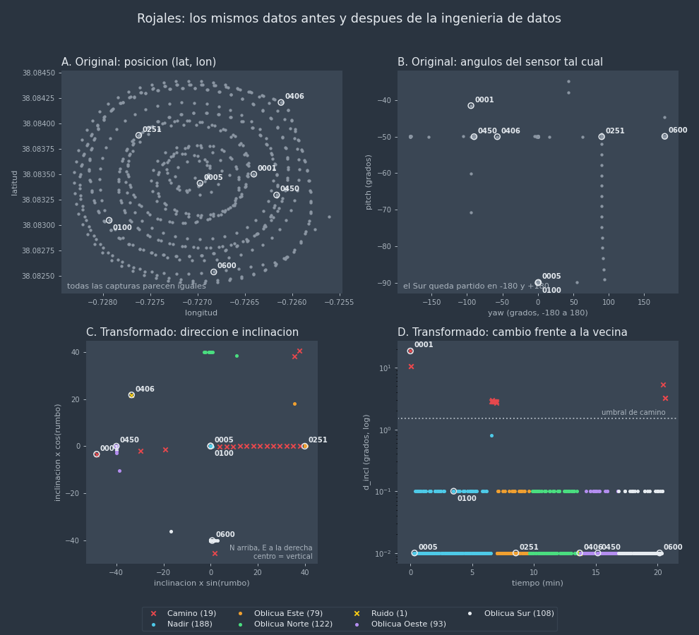

---

## 5. Datos para el modelo, gráficos para la persona

Los datos limpios sirven al modelo: el SfM y el splat. Pero el mismo resultado tiene que verse en un gráfico que una persona entienda sin dudas. Un número como "96,7 % de misión" no dice si el método se equivocó. Un gráfico donde la misión es una línea plana y el camino es una rampa roja sí lo dice, de un vistazo.

Esto importa todavía más cuando el método lo propone un modelo de lenguaje (LLM). Este método se construyó así, con un LLM como asistente, y sus primeras propuestas eran razonables en el papel y malas en los datos:

| Lo que proponía el método | Lo que vio la persona en el gráfico | Lo que cambió |
|---|---|---|
| Una cantidad mínima de oblicuas | Para llegar al mínimo entraban capturas "aleatorias" | Fuera la regla: solo grupos densos |
| Agrupar también por posición | La espiral salía partida en anillos | Fuera la posición (3.4) |
| Agrupar sin variables de estabilidad | Las capturas 0844–0862 de Curvelo eran un camino recto, no misión | Nuevas variables d_incl y d_alt (3.1) |
| Nadir y oblicuas en un solo análisis | Cada tipo necesita sus propias variables | Dos procesados, dos gráficos (3.4) |
| Rumbo absoluto en todas las rutas | En Divinópolis el sensor giraba muy despacio entre vueltas | Esquema "apunta" + recorte del encadenamiento (4) |

Ninguno de estos errores se veía en las métricas. Todos se veían en el gráfico.

Por eso la función principal de la persona hoy no es escribir el código:

| Función | Qué hace |
|---|---|
| Visión de punta a punta | sabe dónde puede romperse la cadena, de la ruta al modelo final |
| Análisis del problema | entiende por qué una captura hace daño antes de quitarla |
| Inicio de la solución | elige variables con sentido físico y qué tolerancia es "igual" |
| Refinamiento | mira los gráficos, encuentra el caso que falla y corrige |
| Validación final | acepta el resultado solo cuando el gráfico no deja dudas |

Un método que no se puede ver no se puede validar. Y un método que no se ha validado no debería decidir qué datos entran en una hora de GPU.

---

## 6. Casos reales

Diez rutas completas, de 332 a 1.583 capturas. Seis con solo metadatos EXIF y cuatro también con las poses de COLMAP (Rojales, Divinópolis, Curvelo Água Solene y João Pinheiro h45a).

| Ruta | Capturas | Tamaño | Patrón | Misión | Fuera de patrón | Veredicto |
|---|---|---|---|---|---|---|
| Rojales | 610 | 8,05 GB | cuadrícula: nadir + oblicuas N, E, S, O a 41° | 96,7 % | 20 | filtrar (la mejor ruta) |
| Formiga, condominio | 1.583 | 21,23 GB | nadir a 120 m | 99,7 % | 4 | aceptar |
| Formiga, recursos hídricos | 680 | 6,10 GB | nadir a 119 m | 96,8 % | 22 | filtrar |
| Curvelo, Água Solene | 862 | 12,73 GB | nadir a 140 m | 96,5 % | 30 | filtrar |
| Curvelo, eucalipto | 495 | 4,82 GB | nadir a 110 m | 94,9 % | 25 | filtrar |
| João Pinheiro h45a | 851 | 13,41 GB | espiral nadir a 48 m | 94,8 % | 44 | **descartar**: domo en la SfM |
| Belo Horizonte, Caiçara | 636 | 6,75 GB | nadir a 60 m | 93,1 % | 44 | filtrar |
| João Pinheiro h30a | 926 | 14,29 GB | espiral nadir a 33 m | 91,7 % | 77 | filtrar (sustituye a h45a) |
| Pompeu | 588 | 5,76 GB | nadir a 50 m | 83,7 % | 96 | filtrar |
| Divinópolis | 332 | 0,88 GB | espiral: nadir + oblicuas hacia dentro y fuera | 78,6 % | 71 | filtrar (revisar el giro) |

Con poses de COLMAP, las cifras salen de ellas y la altura es sobre el suelo. En las demás, la altura es sobre el punto de salida. Las dos rutas de João Pinheiro se dan con EXIF, para compararlas igual.

### Cómo leer los gráficos

Cada ruta tiene dos gráficos (nadir y oblicuas) con siete paneles:

| Panel | Qué mirar |
|---|---|
| **Posición del sensor** (izquierda) | Dónde está el sensor en cada captura. En oblicuas, una flecha hasta el centro de la imagen en el suelo. Las cruces llevan el número de la captura. La línea verde punteada es el área del proyecto. |
| **Inclinación en el tiempo** | Una misión es una línea horizontal. Una rampa es el sensor girando: camino. En gris, las capturas del otro procesado. |
| **Altura en el tiempo** | Lo mismo con la altura: subidas, bajadas y llegada. |
| **Cambio frente a la vecina** | Escala logarítmica. Las capturas de misión se juntan abajo a la izquierda. Las líneas punteadas son los umbrales de "camino". |
| **Variables de HDBSCAN** | Inclinación frente a altura: cada grupo de misión es un punto denso. |
| **Dirección** (polar) | Rumbo, o "apunta" en rutas en órbita (0 = hacia dentro). La distancia al centro es la inclinación. |
| **Barras** | Capturas de cada grupo. |

Colores: azul, verde, naranja y violeta para los grupos de misión; rojo para camino; amarillo para ruido; rosa para horizonte; gris para duplicadas.

### 6.1 Rojales: la ruta bien equilibrada

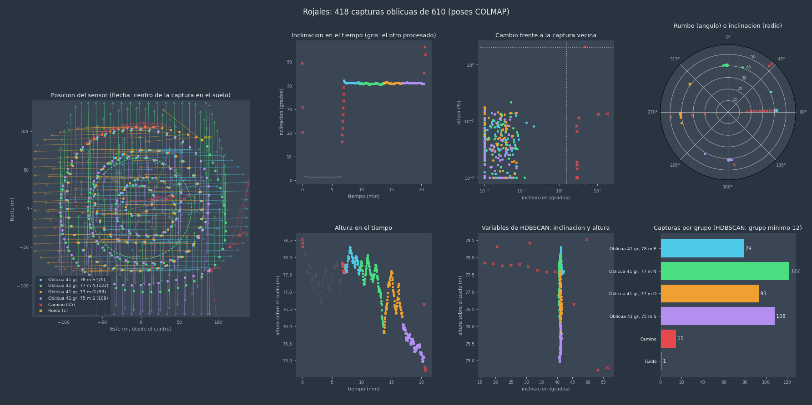

La mejor ruta del conjunto. Una cuadrícula con las cuatro direcciones a la misma inclinación (41°) y la misma altura (77 m sobre el suelo; 60 m sobre el punto de salida), más una pasada nadir:

| Grupo | Capturas |
|---|---|
| Nadir, 77 m | 188 |
| Oblicua 41°, Norte | 122 |
| Oblicua 41°, Sur | 108 |
| Oblicua 41°, Oeste | 93 |
| Oblicua 41°, Este | 79 |
| Camino | 19 |
| Ruido | 1 |

En "inclinación en el tiempo" se ve la misión como una línea plana a 41°, y al principio y al final las rampas del sensor (rojo). Cada punto del suelo se ve desde arriba y desde los cuatro lados con la misma escala. Es el caso ideal para el modelado 3D, **siempre que se quiten las 19 capturas de camino y la solitaria de ruido**.

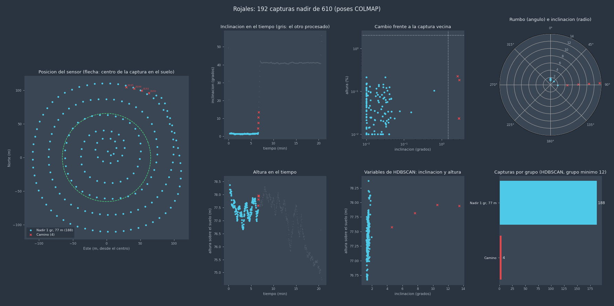

### 6.2 João Pinheiro: h45a frente a h30a, la misma área en dos rutas

Dos rutas en espiral nadir sobre la misma área, el mismo día: una a 48 m (h45a) y otra a 33 m (h30a). Son datasets equivalentes, y sirven para elegir.

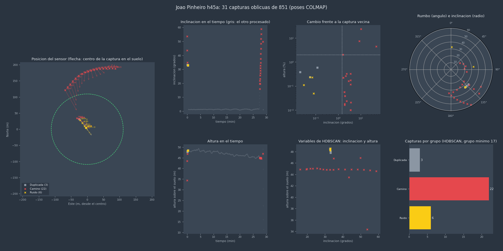

**El patrón.** En las dos rutas todas las oblicuas son del camino. En h45a, las 30 oblicuas son la salida (0004–0015, con el sensor bajando de 54 a 33°), la vuelta (0830–0846, con el sensor subiendo de 17 a 59°) y una última captura, la 0864. Ningún grupo de misión. Fue el primer aviso: un primer método de selección, sin estas variables, había metido 24 de ellas en un conjunto de entrenamiento.

**La inconsistencia.** Para h45a teníamos también las poses de COLMAP. La altura de cada captura según la reconstrucción, comparada con la altura del GPS, muestra un **domo**: el 10 % de capturas más cerca del centro queda 1,2 m más alto y el 10 % más lejos, 1,7 m más bajo, con una correlación de −0,89 frente a la distancia al centro. La ruta real es plana (altura GPS de 47,9 a 48,1 m). La deformación es de la SfM, no del vehículo.

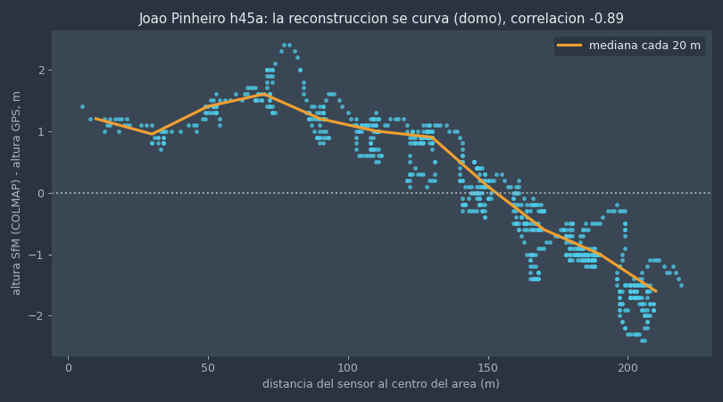

```python
d = alt_colmap - alt_gps        # la misma captura medida por dos fuentes: diferencia en m
d = d - median(d)               # se quita la diferencia común (cada fuente tiene su cero)
corrcoef(dist_al_centro, d)     # -0,89: cuanto más lejos del centro, más baja la SfM
```

Un domo así se hereda en todo lo que viene después: la malla, la nube y el splat. Por eso h45a se descartó y se usó h30a.

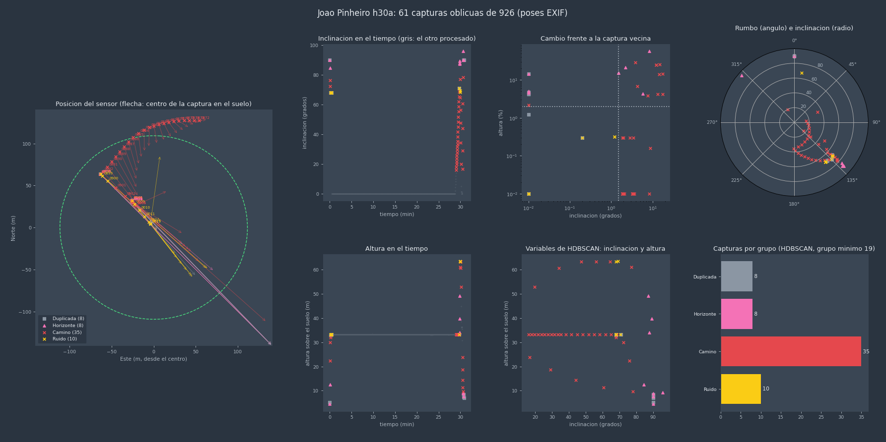

h30a tiene más capturas fuera de patrón (77), pero son fáciles de quitar: 45 de camino, 13 de ruido, 11 duplicadas (el vehículo parado al salir y al llegar) y 8 casi horizontales (5 al salir o al llegar, a menos de 13 m, y 3 seguidas a 34–49 m). Su nadir es muy regular: 849 capturas a 33,2–33,3 m, una cada 6 m.

### 6.3 Divinópolis: un giro del sensor muy lento

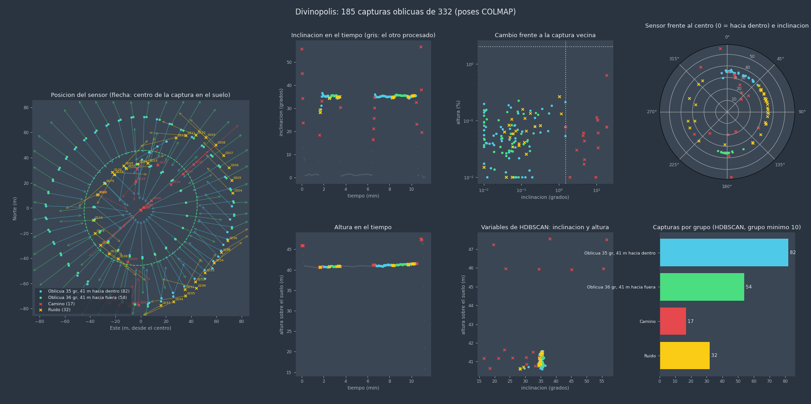

Una espiral con oblicuas a 35° que miran al centro en unas vueltas y hacia fuera en otras. Con el rumbo absoluto salía un solo grupo de "todos los rumbos". Con "apunta" aparecen los dos grupos del plan:

| Grupo | Capturas |
|---|---|
| Nadir, 41 m | 125 |
| Oblicua 35°, hacia dentro | 82 |
| Oblicua 36°, hacia fuera | 54 |
| Camino | 29 |
| Ruido | 36 |
| Duplicada | 6 |

El ruido tiene una causa concreta. Entre una vuelta "hacia dentro" y otra "hacia fuera", el sensor gira muy despacio, durante 5 a 10 capturas, y en algunos tramos se queda con el rumbo fijo mientras el vehículo avanza (0101–0108 con rumbo 131°, 0298–0309 con 317°). Esas capturas ven el centro de lado y de forma irregular. Es la ruta con menos misión (78,6 %): se puede usar, pero la ruta merece revisión.

### 6.4 Curvelo, Água Solene: el camino de vuelta

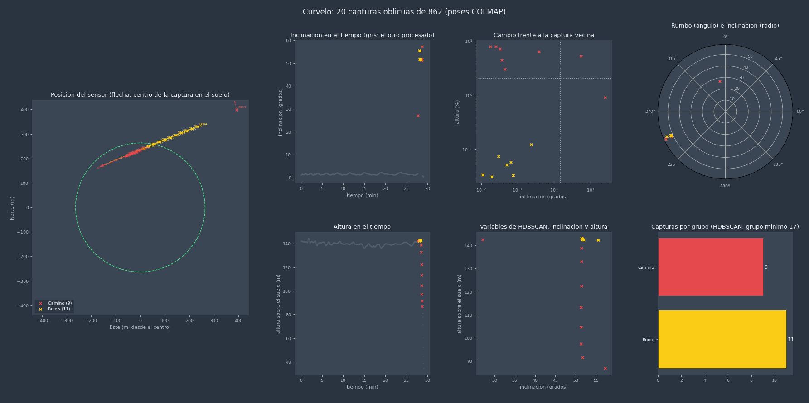

832 nadir a 140 m, sin oblicuas de misión. Las capturas 0844–0862 son el camino de vuelta: el sensor fijo a unos 52° y el vehículo yendo hacia el oeste. Las once primeras van a la altura de la misión (ruido: no forman grupo). Las ocho últimas ya bajan entre un 3 y un 8 % por captura (camino). En el mapa forman una línea recta que sale del área. Las otras 11 fuera de patrón son una captura de camino (0833) y la llegada (0865–0874). Si entran en el entrenamiento, el splat tiene que explicar el paisaje lejano que ellas ven.

### 6.5 Pompeu: capturas mirando al horizonte

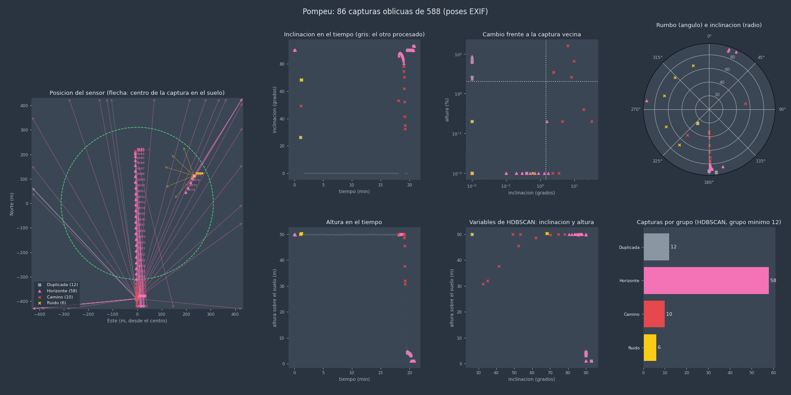

Al final de la misión, el vehículo vuelve hacia el punto de salida con el sensor casi horizontal (80–93°) y sigue capturando: 58 capturas de horizonte, el 10 % de la ruta. Para la SfM son capturas sin puntos en común con la misión. Para el splat son cielo y paisaje lejano: el peor tipo de dato (sección 1).

### 6.6 Belo Horizonte, Caiçara: capturas extra después de la misión

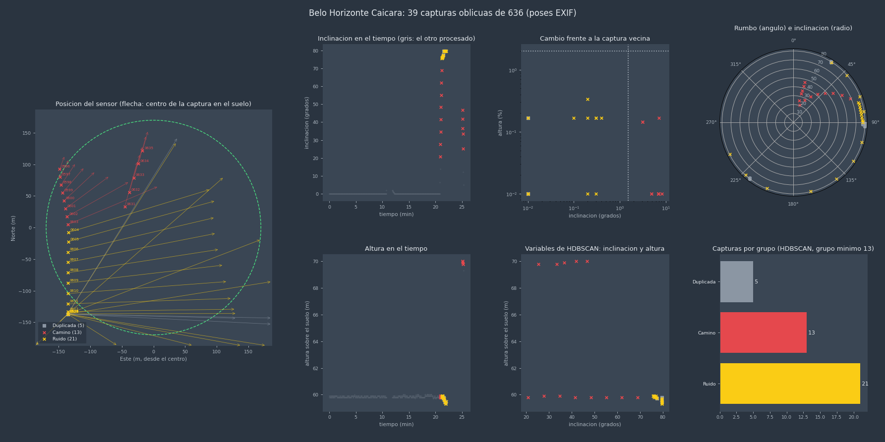

Terminada la nadir, alguien tomó una serie desde el borde oeste con el sensor casi horizontal (76–80°, justo por debajo del umbral de horizonte): 21 capturas de ruido, primero mirando al este y después girando, de 32 a 244°. A los 25 minutos del inicio hay otra serie corta a 70 m, con el sensor bajando (camino). Son capturas útiles para otra cosa (un panorama), no para este modelo.

### 6.7 Curvelo, eucalipto: duplicadas en los giros

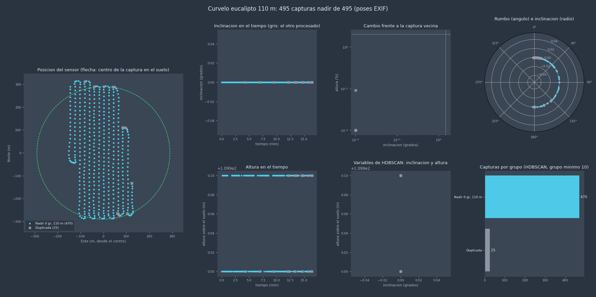

Cuadrícula nadir perfecta a 110 m. Las 25 duplicadas (cuadrados grises) están en los extremos de las pasadas: el vehículo frena para girar y toma dos o tres capturas casi en el mismo sitio. No hacen daño grave, pero pesan el doble en esas zonas. Se queda solo la primera.

### 6.8 Formiga, condominio: la ruta limpia

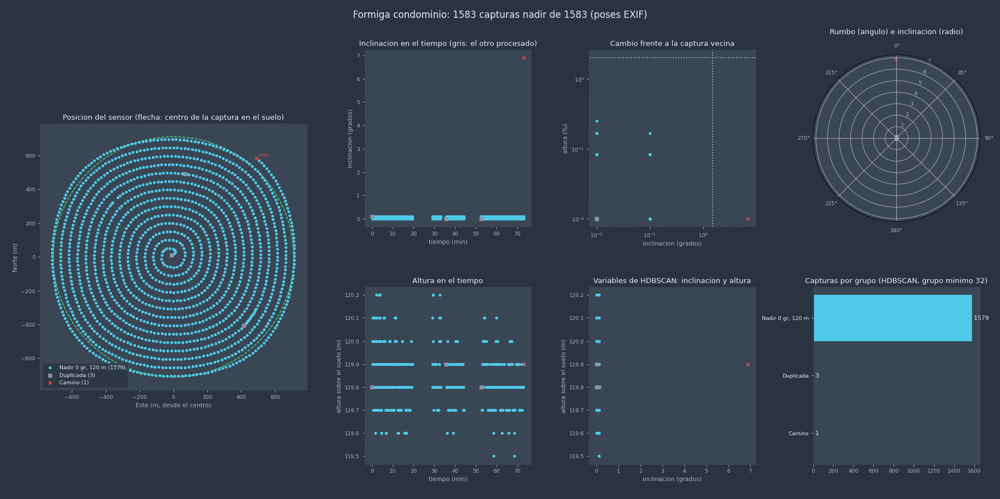

1.583 capturas, 99,7 % de misión, solo 3 duplicadas y 1 de camino. Así se ve una ruta que se puede procesar sin tocar.

---

## 7. Qué ganamos

| Sin control previo | Con control previo |
|---|---|
| Se descubre el problema mirando el modelo 3D terminado | Se descubre en segundos, con los metadatos |
| ~1 h de GPU por intento, más horas de revisión humana | La ruta mala no llega a la GPU |
| La causa (30 capturas de 900) es difícil de encontrar en el modelo | Cada captura tiene grupo y motivo |
| Se reentrena cambiando parámetros a ciegas | Se filtra, o se repite la ruta con el plan corregido |

La regla práctica que usamos:

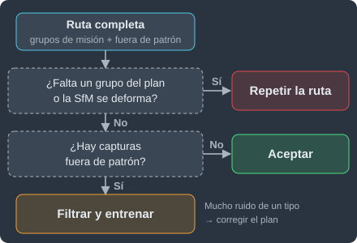

---

## Anexo: técnicas usadas

| Etapa | Técnica | Dónde |
|---|---|---|
| Extracción | lectura parcial de binarios: solo los primeros KB de cada archivo | 2.2 |
| Integración | dos fuentes de la misma pose (GPS + reconstrucción), proyección a UTM | 2.3 |
| Ingeniería de variables | variables derivadas (inclinación, rumbo), relativas (apunta) y temporales (d_incl, d_alt) | 3.1 |
| Series temporales | diferencia con la vecina más parecida, en una ventana de 10 s | 3.1 |
| Categorización | reglas físicas con etiqueta y motivo para cada captura | 3.2 |
| Limpieza de datos | deduplicación de capturas casi idénticas: vecinas en posición y dirección del sensor | 3.2 |
| Transformación | logaritmo para la escala, seno y coseno para los ángulos | 3.3 |
| Normalización | por tolerancia del dominio, no por la varianza de los datos | 3.3 |
| Selección de variables | solo las que dicen el tipo de captura (inclinación, altura, dirección); la posición queda fuera | 3.4 |
| Selección de modelo | estadística circular (longitud media resultante) para elegir el esquema | 3.4 |
| Agrupamiento | HDBSCAN, sin número de grupos fijado | 4 |
| Detección de atípicos | ruido de HDBSCAN + recorte por desviación angular | 4 |
| Validación | correlación entre fuentes (prueba del domo) | 6.2 |
| Visualización | gráficos de diagnóstico para la revisión humana | 5 |

Nada de esto es nuevo. Casi todo existe desde hace décadas. Lo que importa es elegir bien cada paso para este problema.
